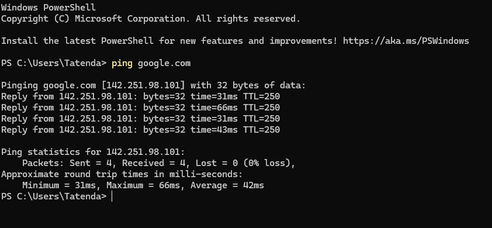
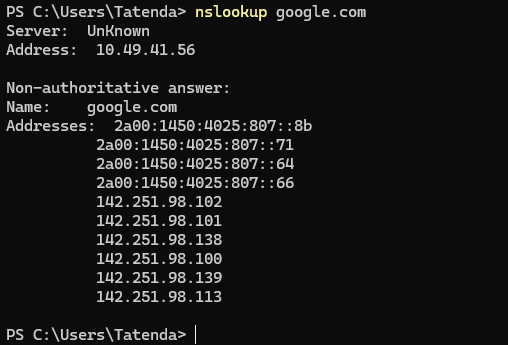
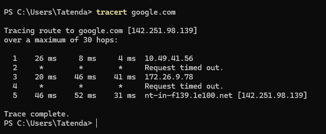

# My Network Report (phone hotspot)

## Problem
I wanted to understand how my network works and how to check it with basic commands.

## Steps
- **ping google.com:** ping checks whether I can reach google.com and measures the round-trip time. My result was 0% packet loss and an average of 42 ms.
- **nslookup google.com:** nslookup asks a DNS server for the IP addresses behind a name. For google.com it returned several IPv4 and IPv6 addresses.
- **tracert google.com:** tracert showed the route from my laptop to google.com in 5 hops, starting with my phone. Two hops timed out, which is normal because some routers ignore these packets.

## Evidence

### ping

0 of 4 packets lost, average round-trip time 42 ms.

### nslookup

The DNS server at 10.49.41.56 answered with several IPv4 and IPv6 addresses.

### tracert

Five hops to Google. Hops 2 and 4 timed out, and the trace still completed.
